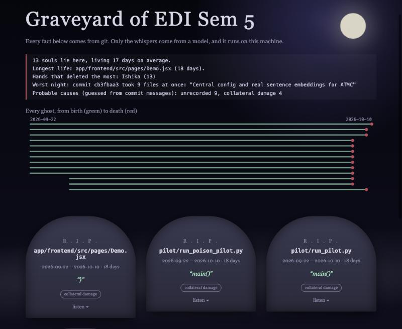

# Git Séance

Raise the dead files of your repository, question them, and find out what is still haunting your code.

Git Séance digs through a repo's history for deleted text files. Every fact about each one comes from git. A local open-weight model, run through [Ollama](https://ollama.com) on localhost, only gives it a voice.

```
  THE CORONER'S REPORT
  13 souls lie here, living 17 days on average.
  Longest life: app/frontend/src/pages/Demo.jsx (18 days).
  Hands that deleted the most: Ishika (13)
  Worst night: commit cb3fbaa3 took 9 files at once: "Central config and real sentence ..."
  Probable causes (guessed from commit messages): unrecorded 9, collateral damage 4

  ╭─────────────────────────────────────╮
  │             R . I . P .             │
  │      pilot/run_poison_pilot.py      │
  │       2026-09-22 - 2026-10-10       │
  │       lived 18 days, 157 lines      │
  │               "main()"              │
  │  cause of death: collateral damage  │
  ╰─────────────────────────────────────╯
```



[`examples/`](examples) holds a real run on one of my own repositories: the [graveyard page](examples/graveyard.html) (download and open it, GitHub shows HTML as text), the [ofrenda](examples/ofrenda.md) and the raw [terminal output](examples/terminal-output.txt).

## What it does

| Feature | What you get | Where the facts come from |
|---|---|---|
| **Headstones** | Born and died dates and authors, both commit messages, lifespan, size, last line | `git log`, `git show` |
| **Hauntings** | Living lines that still mention a dead file, such as an import of a module that no longer exists | `git grep` on HEAD |
| **Reincarnations** | Files that were only renamed (for example `.js` to `.jsx`) are reported as alive, not as ghosts | `git ls-files` |
| **Coroner's report** | Who deleted the most, the commit that was a mass grave, average lifespan, probable causes | `git log` (causes are a keyword guess, labelled as such) |
| **Whispers** | A few sentences in the dead file's voice, streamed live as the model writes | local model |
| **Last rites** (`--last-rites`, `--install-hook`) | Run before you commit: for every file you have staged for deletion, it lists the living code that still mentions it, so a broken delete is caught before it lands. As a `pre-commit` hook it warns on every commit; `--strict` makes it fail; `--eulogy` lets each file say goodbye | `git grep --cached` on the staged index |
| **Successors** | What replaced a dead file: a git rename, or the file added in the same commit whose lines overlap most (30% or more, shown as a percentage) | `git diff-tree`, line overlap |
| **Zombies** | Files that died and came back, and how many times | `git log` |
| **Lifespan chart** | In the HTML page: one bar per ghost from birth (green) to death (red) | `git log` |
| **`--talk`** | A séance: ask a deleted file questions. It only knows its own code and facts, and says "I do not remember" otherwise | local model, grounded in the file |
| **`--raise`** | Writes a file's last living version into a folder of your choice. Your repo is never touched | `git show` |
| **`--html`** | A self-contained spooky graveyard page (no network, no scripts): click a tombstone to hear it | all of the above |
| **`--out`** | An ofrenda: a markdown file of every headstone and whisper | all of the above |

## Install

Python 3.10+ (standard library only), git, and [Ollama](https://ollama.com) with a model pulled (the model is optional: `--no-model` gives you every git fact without it).

```bash
pip install git+https://github.com/Ishika-eng/git-seance   # gives you the `git-seance` command, and so `git seance`
```

Or skip installing and run `python3 seance.py` from a clone. (Git intercepts `git seance --help` looking for a man page, so use `git seance -h`.)

## Run it

```bash
ollama pull qwen2.5-coder:7b-instruct

git seance --install-hook                                   # warn on every commit that deletes a still-referenced file
git rm billing/invoice_formatter.py && git seance --last-rites --eulogy   # or run it by hand

python3 seance.py /path/to/repo --limit 5                  # report, headstones, hauntings, whispers
python3 seance.py /path/to/repo --html graveyard.html      # the graveyard page
python3 seance.py /path/to/repo --talk 2                   # hold a séance with ghost number 2
python3 seance.py /path/to/repo --raise old/module.py      # restore it into ./resurrected
python3 seance.py /path/to/repo --no-model                 # facts only, no model needed
python3 seance.py /path/to/repo --model gemma3:4b          # any local model
```

## Privacy

The only network call is to `localhost:11434`. Your history, file contents and commit messages never leave the machine. The generated HTML loads nothing from the network. The files people delete are often the ones they would not paste into a hosted API.

## Honest limits

- **The voice can invent.** The model is told to use only the facts and to admit when it does not know, and it often does ("the reason is not recorded"). A 7B model still sometimes over-reads a commit message and states a reason as fact. The headstone and report are git facts; the whisper is not.
- **Hauntings are text matches, not a parser.** They search for the full path, the path without its extension, and the bare name only when it is distinctive (8+ characters, not generic, and not shared with a living file). They can miss references written another way and can still match prose. Treat a haunting as a lead to check.
- **Successors are a similarity guess.** A git rename or a 90%+ match is strong evidence. Anything under about 60% only means "a file added in that commit looks somewhat like it".
- **The hook warns, it does not block**, unless you add `--strict` to the line in `.git/hooks/pre-commit`. It never overwrites a hook it did not install. Last rites finds mentions by text search, with the same limits as hauntings.
- **Causes of death are guessed** from keywords in the deleting commit's message.
- It lists files deleted outright. It scans the 400 most recent deletions, skips files over 200 KB or with binary data, and shows the model only the first 2,500 characters of a file.
- Tested with Qwen2.5-Coder 7B on an M3 Pro: roughly 10 seconds per ghost.

## Tests

```bash
PYTHONPATH=. python3 -m unittest test_seance
```

33 tests build throwaway git repos and need git but not Ollama. They cover the facts, hauntings (including the false positives we hit on real repos), reincarnation, successors, zombies, the coroner, last rites (including a real `git commit` with the hook installed, and refusing to overwrite someone else's hook), `--raise` (including refusing paths that escape the folder), `--talk` with a mocked model, the lifespan chart, and HTML escaping of everything that comes from history.
